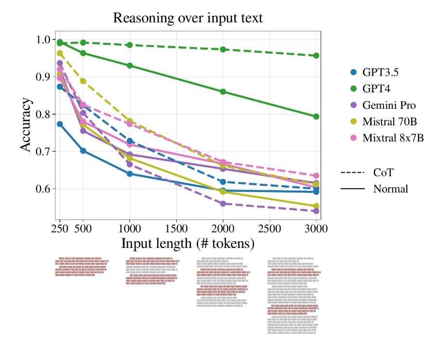

# Here the most important graph:
[*Same Task, More Tokens: the Impact of Input Length on the Reasoning Performance of Large Language Models*](https://huggingface.co/papers/2402.14848) (2024-02-19; Mosh Levy, Alon Jacoby, Yoav Goldberg) suggests that reasoning capacity drops off pretty sharply from 250 to 1000 tokens, starting to flatten out between 2000-3000 tokens.

> **"Context engineering is the delicate art and science of filling the context window with just the right information for the next step." — [**Andrej Karpathy**](https://x.com/karpathy/status/1937902205765607626)**
    

So what we see here ?
- Different methods/models creates more accurate results, but benchmarks are changing everyday. So best business ideas are usually are not creating best models.

In practice, best enablement of AI tools is connecting models inputs-outputs all together and reducing the context window somehow. For now, people are creating "git diff" like patches, to-do list, done-list and so on.

I see agentic workflows as same as humans. Overtime, SWEs learn how to deal with immense amount of data. We create set of tools to reduce context window. And all the mile stones in developer experience follows :
1. Create a solution[assembly] but it is hard to solve bugs, hard to coordinate at scale
2. Create wrapper of a solution[compiler] but hard to find people willing to learn all those little details & optimizations
3. Improvements & developments wrapper [multiple programming languages] but now, people need to learn multiple languages. 
All of the sudden industry looks for, "C++14 expert + Rust + Go developer who can scale db systems".

It is always just too much information to consume in a first place.
And When i look from business perspective, 

## Milestones of software development
- Assembly -> C, C -> Java, C -> Python like milestones. Easier to access/manage to business logic. Overall less context to deal with, straight to business. Nowadays, the programming language and business logic is already paired well. %99 the time, no one plays outside of the business logic. Most decisions are made for fast PoC with most already available sw support. People needs to learn compiler configurations, tricks, algorithms, standart libraries. 
- Manual Testing -> Testing Frameworks/Teams. Just release it process -> QA process. DevOPS/Container solutions.  Making things costs less, constantly checking the latest status.
- OpenSource/FreeSource

For the next iteration phase of software development, we need to figure put a effective way to feed AI systems with observability data[logs, metrics, traces]. 
