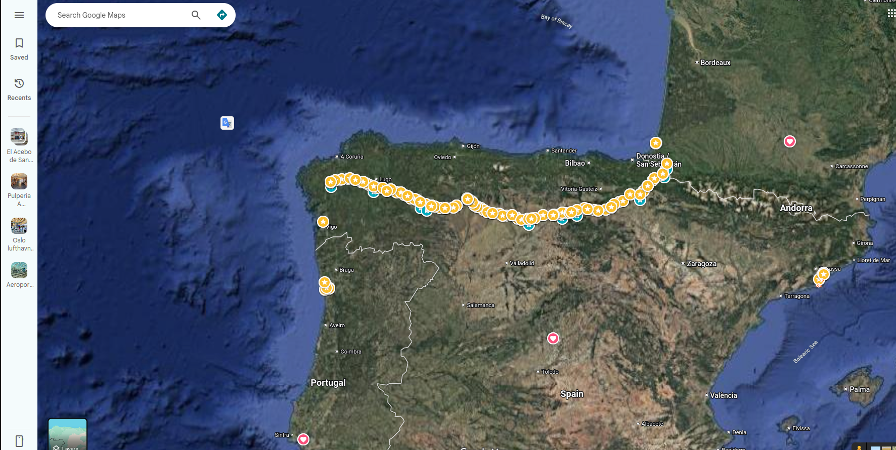
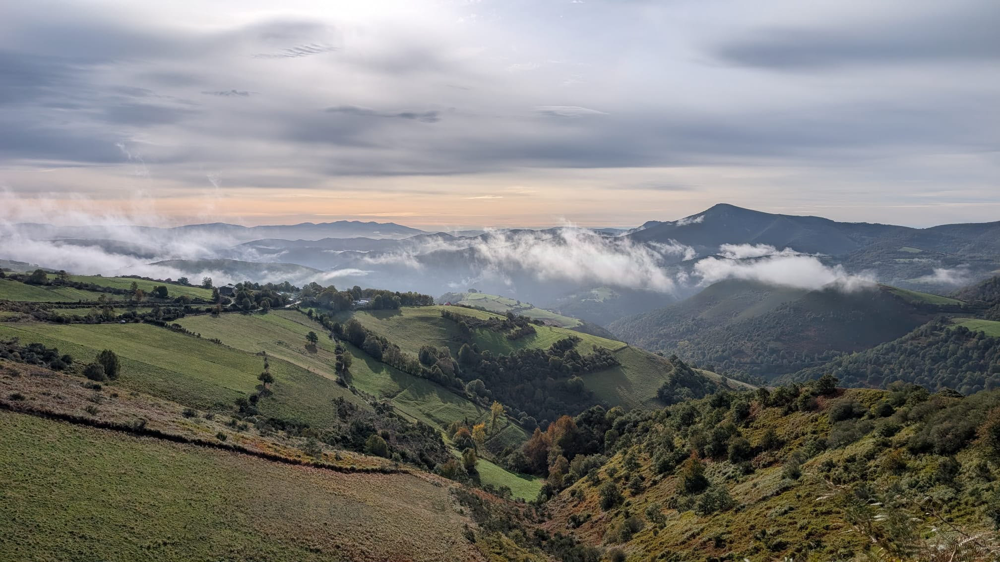
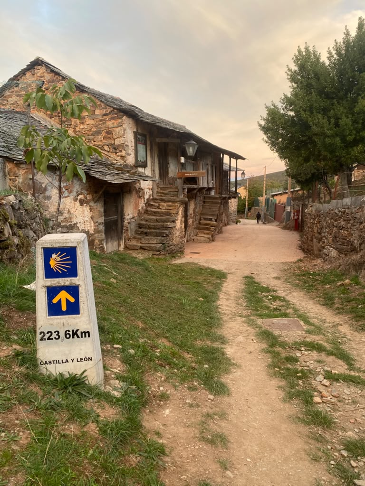
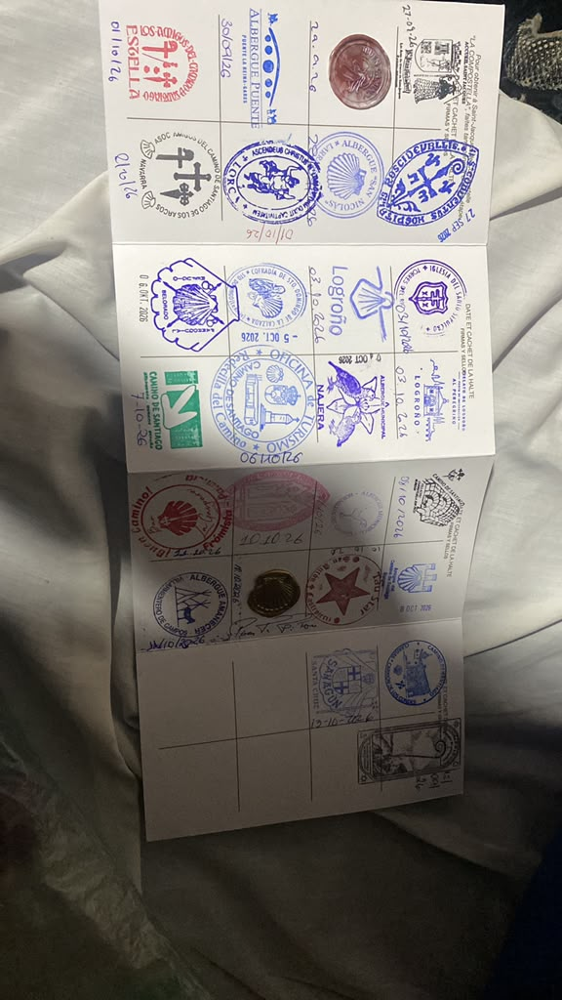
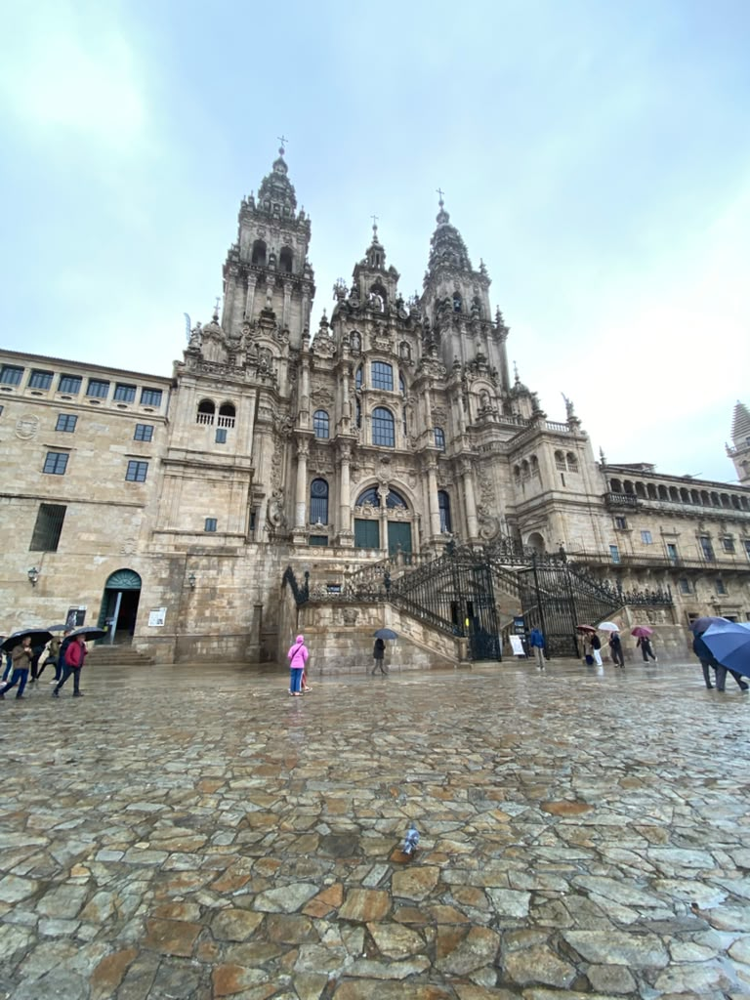

# What I Learned Walking the Camino Francés

In June, I left my job at Texas Instruments Norway. This year marks my tenth year in the software engineering industry and my sixth year in Oslo. The last 15 years have been fun and stressful, and I decided it was time to relax and figure out things slowly.

I had wanted to walk the Camino Francés for a long time, and finally had both the time and energy to do it. I walked from Saint-Jean-Pied-de-Port in France to Santiago de Compostela in Spain: about 810 km over 30 days. A former colleague joined me for the last 10 days, from León to Santiago.

*The route across Northern Spain.*

## What I learned along the way

- Walking is a great way to lose weight. I burned an extra 1,500 calories a day, easily.
- Having a goal keeps you moving and helps you push through pain.
- I’m good at walking for hours and talking all day.
- Spain is affordable. Good, organic food and time with friends are crucial in life.
- The weather in Spain was lovely. It was my first time spending an extended period there.

*Views along the way.*

## What I’m looking for next

- A couple of friends within an hour by train, so we can swim, walk, talk, cycle, and spend time together.
- More chances to eat out. Norway is so expensive that eating at restaurants regularly doesn’t feel practical.
- A way to make winter in Norway feel less depressing.
- More new experiences in Oslo. Maybe I need to find new ways to welcome them into my life.

## A few moments from the Camino

*A place to stop and rest along the route.*

*My pilgrim credential, stamped along the way.*

*Santiago de Compostela, the end of the walk.*
